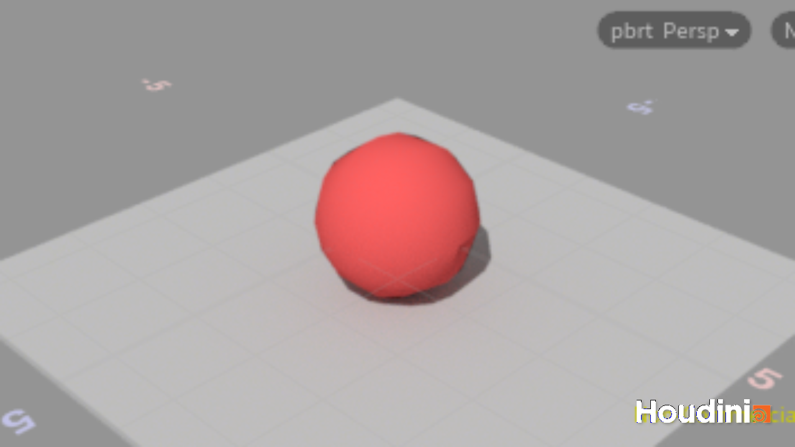

# hdPbrt

A Hydra render delegate for [pbrt-v4](https://github.com/mmp/pbrt-v4), for Houdini 22 Solaris
and Blender 5.3. CPU only.



## How it works

The delegate does not link pbrt. pbrt keeps process-wide state and calls `exit()` on scene
errors, so it runs as a separate process instead:

1. Hydra prims sync into a light copy of the scene. Meshes are triangulated and written to
   binary PLY files as they change.
2. When the scene, camera, settings or viewport size change, the delegate writes a `.pbrt`
   scene, restarts pbrt (debounced while tumbling) and listens on a local socket.
3. pbrt streams its progressive image, plus first-hit depth, over its tev display-server
   protocol. The final image is read from the PFM pbrt writes when it exits.

pbrt needs the seven patches in `patches/` (against pbrt-v4 `20e41fd`): pbrt exits when its
parent process dies, its RGB film can record and stream depth, per-pixel prim/instance
ids (selection) and coverage (alpha) for the viewport, triangle meshes can deform over
the shutter (deformation motion blur), and instances and meshes take N motion keys (curved
motion blur), and animated transforms with a reflection interpolate correctly (moving
cameras).

## Build

```bash
scripts/build.sh                 # pbrt + Houdini flavor, into ./install/houdini
BLENDER=1 USD_SOURCE=... TBB_INCLUDE=... scripts/build.sh   # also the Blender flavor
```

The Houdini flavor builds against `$HFS` (default `/opt/hfs22.0`). The Blender flavor builds
against Blender's `libusd_ms.so` with OpenUSD v26.08 source headers and the generated
`pxr.h` in `third_party/usd-blender-generated`. Details and gotchas are in
[docs/BUILD_NOTES.md](docs/BUILD_NOTES.md).

## Use

- **Houdini:** put a `dso/usd_plugins/plugInfo.json` that includes the install dir on
  `HOUDINI_PATH` (Houdini ignores `PXR_PLUGINPATH_NAME` set from a package), then pick
  **pbrt** in the LOP viewport's renderer menu.
- **Blender 5.3:** install `blender/hydra_pbrt` as an add-on (its `plugin` folder points at
  the Blender build) and choose **Hydra pbrt** as the render engine.

Render settings: `pbrt:pixelSamples`, `pbrt:maxDepth`, `pbrt:integrator`, `pbrt:sampler`,
`pbrt:threads`, `pbrt:regularize`, `pbrt:depthOfField` (default on),
`pbrt:motionBlur` (default on),
`pbrt:xformSamples` / `pbrt:geoSamples` (motion keys over the shutter, default 2),
`pbrt:subdivLevel` (uniform subdivision of catmullClark/loop meshes, default 2, 0 = off),
`pbrt:volumeDensity` (1), `pbrt:volumeAlbedo` (0.9), `pbrt:volumeTemperatureScale` (0: no emission),
`pbrt:exportPath`.

Environment: `HDPBRT_PBRT_EXECUTABLE`, `HDPBRT_TMPDIR`, `HDPBRT_KEEP_TMP=1`,
`HDPBRT_DEBUG=1` (prints AOV bindings and mesh primvars), `HDPBRT_REVERSED_DEPTH=0/1`
(Houdini's Vulkan viewport expects reversed depth, the default in the Houdini build).

## Supported

Meshes (catmullClark/loop subdivision with OpenSubdiv, creases, holes), implicit shapes,
basis curves (bspline, bezier, catmullRom, linear; tubes or ribbons), points (spheres),
point instancers, volumes (OpenVDB fields as a pbrt NanoVDB medium); UsdPreviewSurface and MaterialX standard_surface /
open_pbr_surface (mapped to pbrt conductor, dielectric or coateddiffuse) with image textures;
distant, sphere, rect, disk, cylinder and dome lights; perspective and orthographic cameras,
depth of field from the camera's fStop and focusDistance (thin lens), transform motion blur
over the camera shutter (meshes and point instances) and deformation blur for meshes whose
points are time-sampled, with N keys for curved motion, and camera motion (two keys);
color, depth, primId and instanceId AOVs (viewport selection, including point instances).
Without a dome light the background is transparent, so the host's viewport background shows.
Not yet: light shaping, velocity motion blur, volume materials,
in-memory Houdini volumes (write VDBs to disk).

## Tests

`tests/`: hython and Blender render scripts and a test scene. `tests/viewport/vp_test.py`
drives a live Solaris viewport and flipbooks it (see the Tests section of the build notes for
running it in a headless compositor).

## License

Apache-2.0 (see `LICENSE`). Parts of the render buffer, instancer and implicit-surface plugin
are adapted from USD's hdEmbree (Apache-2.0, Pixar). `third_party/usd-blender-generated/pxr/pxr.h`
is generated from OpenUSD and is under its license.
